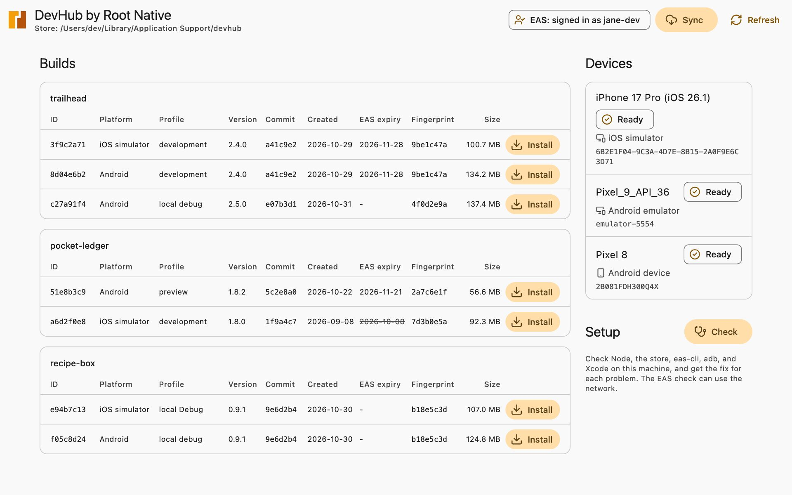
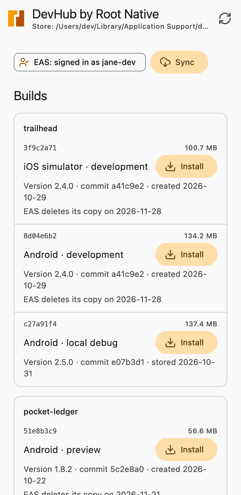
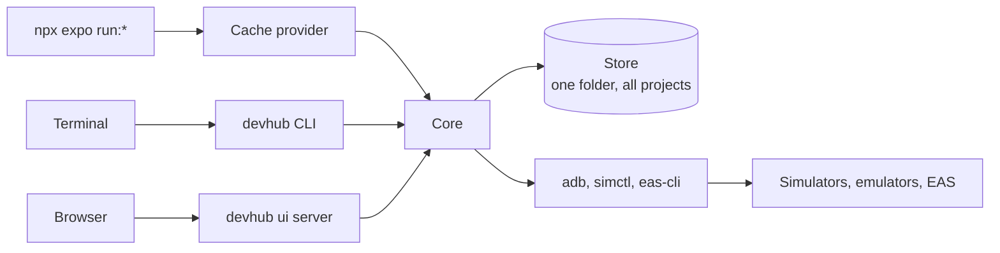

<p align="center">
  <a href="https://rootnative.github.io/devhub/">
    <picture>
      <source media="(prefers-color-scheme: dark)" srcset="assets/brand/devhub-mark-dark.svg" />
      
    </picture>
  </a>
</p>

<h1 align="center">DevHub by Root Native</h1>

<p align="center">
  Keep every Expo development build on your machine.<br />
  Find the build that matches your code, and install it in one click.
</p>

<p align="center">
  <a href="https://github.com/rootnative/devhub/actions/workflows/ci.yml"></a>
  <a href="https://github.com/rootnative/devhub/actions/workflows/deploy-web.yml"></a>
  <a href="https://www.npmjs.com/package/@rootnative/devhub"></a>
  
  
  <a href="LICENSE"></a>
</p>

<p align="center">
  <a href="https://rootnative.github.io/devhub/"><b>Read the docs</b></a>
  ·
  <a href="#-quick-start">Quick start</a>
  ·
  <a href="#-commands">Commands</a>
  ·
  <a href="https://rootnative.github.io/devhub/llms.txt">LLM docs</a>
</p>

<p align="center">
  <picture>
    <source media="(prefers-color-scheme: dark)" srcset="assets/docs/screenshots/page-dark.jpg" />
    
  </picture>
  <br />
  <sub>The <code>devhub ui</code> page on <code>main</code>, with made-up projects. The next release ships this design.</sub>
</p>

> **Status:** alpha. The CLI, the local page, and the Expo build cache
> provider are on npm. The desktop app and the launch of an app are not
> released yet. Each alpha can change the CLI and its JSON output. The
> [CHANGELOG](packages/devhub/CHANGELOG.md) lists what each version has.

## ✨ Features

| Feature | What it does | State |
| --- | --- | --- |
| **Keep your EAS builds** | `devhub sync` downloads each finished EAS dev client build before EAS deletes it. `devhub sync --all` syncs each project that `devhub sync` saw before. | On npm |
| **One library for all projects** | One store folder, outside your projects, holds every build of every project. | On npm |
| **Match by fingerprint** | `devhub match` calculates the native fingerprint with the project's own `@expo/fingerprint`, and shows the stored builds with the same hash. | On npm |
| **Keep your local builds** | As an Expo build cache provider, DevHub stores each build of `npx expo run:*`, and installs a stored build when the native code did not change. | On npm |
| **Install in one step** | `devhub install` installs a stored build on a ready emulator, a USB Android device, or a booted iOS simulator. It checks the SHA-256 of the file first. | On npm |
| **The local page** | `devhub ui` opens a page with the builds, the devices, an install button, and a sync button. | On npm |
| **Setup checks** | `devhub doctor` checks Node, the store, eas-cli, adb, and Xcode, and gives the fix for each problem. | On npm |
| **JSON for scripts and agents** | Each command takes `--json`. The `llms.txt` file in the package gives the help, the JSON types, and the API. | On npm |
| **No telemetry** | DevHub uses the network only for EAS. It never reads, asks for, or stores your EAS token. | On npm |
| **Desktop app** | The local page in a desktop window, with a daily sync in the background. | In code, not released |
| **Launch** | Boot a device, install the build, and open the app with Metro or an EAS Update, in one action. | Planned |
| **Profiles, prune, and import** | Saved pairs of a device and a build, rules that delete old builds, and the import of an `.apk`, `.aab`, or `.app` file. | Planned |

Android works on macOS, Windows, and Linux. iOS works on macOS.

<p align="center">
  <picture>
    <source media="(prefers-color-scheme: dark)" srcset="assets/docs/screenshots/page-narrow-dark.jpg" />
    
  </picture>
  <br />
  <sub>In a narrow window, each build is a row.</sub>
</p>

## 💡 Why

Expo recommends a development build in place of Expo Go. When you work on
many Expo projects, you get these problems:

- Each project needs its own dev client for each platform.
- EAS deletes old builds after a retention period.
- A native build takes minutes. But most of the time the native code did not
  change, and the old build still works.
- Nothing shows which builds you have, and which one matches your branch.

A dev client needs a rebuild only when the native fingerprint changes.
DevHub stores each build with its fingerprint. When your code matches a
stored build, DevHub uses that build, and you do not build again.

## 🚀 Quick start

You need Node 20.19 or later, and an EAS login (`npx eas-cli login`).

```bash
npm install --global @rootnative/devhub
devhub doctor           # check the tools, and get the fix for each problem

cd my-expo-app
devhub sync             # download the EAS dev client builds of this project
devhub match            # show the stored build that matches the current code
devhub install <id>     # install it on a ready device
devhub ui               # or do all of this on the local page
```

To run one command with no install, use `npx @rootnative/devhub <command>`.

> [!NOTE]
> A dev client is a debug build. Its JavaScript runs in development mode, so
> it does not show the real speed of your app in production.

### Keep your local builds

Add DevHub to a project as an Expo build cache provider:

```bash
npm install --save-dev @rootnative/devhub
```

```json
{
  "expo": {
    "buildCacheProvider": { "plugin": "@rootnative/devhub/cache-provider" }
  }
}
```

The first `npx expo run:android` builds the app, and DevHub stores the APK.
The next run with the same native code installs the stored APK, and Gradle
does not run. iOS works the same for a simulator. Read
[Keep your local builds](https://rootnative.github.io/devhub/guides/local-builds/)
for each rule.

> [!TIP]
> EAS deletes old builds. Run `devhub sync --all` every day, so DevHub gets
> each build first.
> [Sync every day](https://rootnative.github.io/devhub/guides/daily-sync/)
> shows the setup for cron, launchd, and Task Scheduler.

## 🧰 Commands

| Command | What it does |
| --- | --- |
| [`devhub sync`](https://rootnative.github.io/devhub/commands/sync/) | Downloads each finished EAS dev client build of the project in the current folder that the store does not have. `--all` syncs each project. |
| [`devhub list`](https://rootnative.github.io/devhub/commands/list/) | Shows the stored builds: project, platform, profile, app version, git commit, date, and the EAS expiry date. |
| [`devhub where <id>`](https://rootnative.github.io/devhub/commands/where/) | Prints the path of a stored build file. |
| [`devhub devices`](https://rootnative.github.io/devhub/commands/devices/) | Lists the Android emulators and devices that adb sees, and on macOS the booted iOS simulators. |
| [`devhub install <id>`](https://rootnative.github.io/devhub/commands/install/) | Installs a stored build on a ready Android emulator or device, or on a booted iOS simulator. |
| [`devhub match`](https://rootnative.github.io/devhub/commands/match/) | Calculates the native fingerprint of the current project, and shows the stored builds with the same fingerprint. |
| [`devhub ui`](https://rootnative.github.io/devhub/commands/ui/) | Starts a local server, and opens the DevHub page in the browser. |
| [`devhub whoami`](https://rootnative.github.io/devhub/commands/whoami/) | Shows the EAS login state. |
| [`devhub doctor`](https://rootnative.github.io/devhub/commands/doctor/) | Checks the tools and the store, and gives the fix for each problem. |

Each command takes `--json`. Results go to stdout, and progress and warnings
go to stderr. The exit code is `0` for success, `1` for a failure, and `2`
for a usage error.

## 🧭 How it works



- **The project's own fingerprint.** DevHub loads `@expo/fingerprint` from
  the project folder, and reads the `fingerprint.config.js` of the project.
  A bundled copy can calculate a different hash, and then you get the wrong
  build or no match.
- **One store for all projects.** The store is plain files in the data
  folder of your system, never inside a project. `DEVHUB_HOME` moves it.
- **Commands as arrays.** DevHub runs adb, simctl, and eas-cli with an array
  of arguments, never a shell string. A space or a quote in a path cannot
  change a command.
- **Public eas-cli commands only.** DevHub never calls a private EAS API.
- **A local page.** The `devhub ui` server listens on `127.0.0.1` only. Each
  run makes a new token, and each API call must send it.

## 🗺️ Roadmap

DevHub grows in small milestones. Each one gives you one useful result.

| Milestone | Result | State |
| --- | --- | --- |
| Keep | EAS dev client builds are never lost | On npm |
| Install | Install a stored build on a running emulator, simulator, or Android phone | On npm |
| Match | See the stored build that matches the current code | On npm. A manual check against a real EAS build is open. |
| Local builds | `npx expo run:*` stores each build, and uses a stored build again | On npm. A CI check passed on Android with Expo SDK 57. The checks on SDK 58 and on iOS are open. |
| Local page | `devhub ui` opens a page with the list, the devices, an install button, and a sync button | On npm. A new design is on `main`. |
| Doctor | `devhub doctor` checks the tools and the store, and gives the fix for each problem | On npm |
| Desktop | The local page in a desktop app, with a daily sync in the background | In code, not released |

## 🤖 Docs for AI agents

Each command takes `--json`, so an agent reads the same output as the local
page. The package ships `llms.txt` with the help of each command, the type of
each JSON output, and the core API of the installed version:
`node_modules/@rootnative/devhub/llms.txt`. The docs site serves the same
file at [llms.txt](https://rootnative.github.io/devhub/llms.txt). Read
[For AI agents](https://rootnative.github.io/devhub/reference/ai-agents/).

## 📚 Documentation

| Page | Read it to |
| --- | --- |
| [Introduction](https://rootnative.github.io/devhub/introduction/) | Learn what DevHub does, and why |
| [Installation](https://rootnative.github.io/devhub/installation/) | Install DevHub and its requirements |
| [Quick start](https://rootnative.github.io/devhub/quick-start/) | Keep, match, and install your first build |
| [Keep your local builds](https://rootnative.github.io/devhub/guides/local-builds/) | Set up the Expo build cache provider |
| [Sync every day](https://rootnative.github.io/devhub/guides/daily-sync/) | Run the sync with cron, launchd, or Task Scheduler |
| [The store](https://rootnative.github.io/devhub/guides/store/) | Learn where DevHub keeps the builds, and how to move the store |
| [JSON output and exit codes](https://rootnative.github.io/devhub/reference/json-output/) | Read the output of each command in a script |
| [Security and privacy](https://rootnative.github.io/devhub/reference/security/) | Learn what DevHub reads, writes, and sends |
| [Package README](packages/devhub/README.md) | Read the full CLI reference |

## 🔧 Tech stack

| Layer | Technology |
| --- | --- |
| CLI and core | Node 20.19 or later, TypeScript 5.9 in strict mode, ESM |
| Runtime dependencies | `cross-spawn` and `json5`, nothing else |
| Build | tsup, Turborepo 2 |
| Tests | Vitest 3, on Linux, macOS, and Windows |
| Local page | An Expo SDK 58 app, exported for the web, and shipped inside the package |
| Desktop app | Electron 44 |
| Docs | Docusaurus 3 |
| Delivery | GitHub Actions, GitHub Pages, and npm with trusted publishing |

## 🛠 Development

You need Node.js 24 (the version in `.nvmrc`) and pnpm 10.

```bash
git clone https://github.com/rootnative/devhub.git
cd devhub
pnpm install
```

| Command | What it does |
| --- | --- |
| `pnpm run build` | Builds the page and the package with Turborepo |
| `pnpm run dev` | Builds the package in watch mode |
| `pnpm run typecheck` | Runs the type check |
| `pnpm run test` | Runs Vitest |
| `pnpm run lint` | Runs ESLint |
| `pnpm run build:llms` | Writes `packages/devhub/llms.txt` from the build |
| `pnpm run preflight` | Runs each check, in the order of a release |
| `pnpm run docs:dev` | Starts the docs site |
| `pnpm run desktop` | Builds and starts the desktop app |

Run the build from the root, so Turborepo exports the page first. Then run
the CLI from the build:

```bash
pnpm run build
node packages/devhub/dist/bin.js --help
node packages/devhub/dist/bin.js ui
```

To run one test file:

```bash
pnpm --filter @rootnative/devhub test -- src/__tests__/cli.test.ts
```

<details>
<summary>Repository layout</summary>

| Path | What it is |
| --- | --- |
| [packages/devhub/](packages/devhub/) | `@rootnative/devhub`: the CLI, the core, the cache provider, and the `devhub ui` server |
| [apps/web/](apps/web/) | The `devhub ui` page. Private. The package ships its build. |
| [apps/desktop/](apps/desktop/) | The Electron app. Private. |
| [docs/](docs/) | The Docusaurus docs site. Private. |
| [example/](example/) | The Expo app that the cache provider check builds. Run it through `example/with-store.mjs`, so a test build does not go into your own store. |
| [scripts/](scripts/) | The `llms.txt` generator, the package and release checks, and the brand generator |

</details>

## 🔒 Security

To report a vulnerability, read [SECURITY.md](SECURITY.md). To learn what
DevHub reads, writes, and sends, read
[Security and privacy](https://rootnative.github.io/devhub/reference/security/).

## 📄 License

[MIT](LICENSE) © 2026 Root Native
